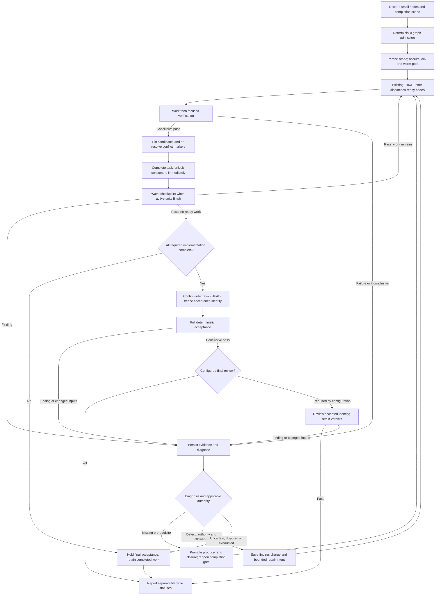

# Software DAG Flow 3.0 architecture

Flow 3 turns declared requirements into small tasks, integrates verified tasks as
they finish, and checks the assembled integration revision. This is the current
architecture; see [configuration and operation](flow3.md) and the
[implementation audit and verification evidence](flow3-acceptance-audit.md).

## One scheduler and one persisted authority

`FlowRunner` owns dispatch, checkpoints, final acceptance, configured review, repair
and recovery. `Run.flowState`, task/node state and the existing store retain the
authoritative records under the existing run lock. `lifecycle.ts` supplies pure
completion, identity and evidence helpers, without another scheduler or state store.

Warm worker slots reuse dependencies; straight chains can reuse their worktree and
supported agent conversation. Ready nodes need completed dependencies, open gates
and available slots. Overlapping file ownership serializes work. Failure blocks
descendants while independent branches continue.

## Distinct completion gates

| Fact | Meaning |
| --- | --- |
| Task completion | Focused verification passed and the candidate landed on integration; consumers may start immediately. |
| Implementation completion | Every required task in the persisted completion scope completed. |
| Acceptance | Conclusive checks passed against a frozen assembled identity. |
| Review | Configured review is off, pending, passed, failed or errored for that identity. |
| Merge | Ordinary Flow 3 reports `integration-only`; no target-branch publication policy exists. |
| Product completion | Whole-product scope satisfied its required work, acceptance and configured review. Scoped success cannot claim this. |

Final acceptance or review failure retains completed tasks and integrated commits.
It holds run/product success and routes findings through diagnosis. Task integration
continues incrementally rather than waiting until the end.

Persist completion mode, required and optional IDs and excluded work. Unclassified
whole-product tasks and required producer closures are required. Explicit subset
selection establishes a scoped target; ordinary resume retains the saved target.
Skipped, gated, failed, unfinished or excluded required work prevents whole-product
completion. Discovering a missing producer reopens the implementation gate before
dependent acceptance. Promotion of a failed producer does not grant retry authority.

## Lifecycle

Admission checks IDs, edges, cycles and declared producers, adding unambiguous
producer edges. Planning agents author small nodes; the runner does not invent
requirements or split tasks. Optional advisory plan review cannot gate startup.

Each node declares `id`, `goal`, `depends_on`, `touches`, `creates`, `relies_on` and
one fast `verify` command. `verify_requires` adds producer edges;
`checkPrerequisites` defers composed checks until producers exist. Worker prompts
assign wave/final acceptance execution to the runner.

## Frozen acceptance identity and conclusive evidence

Each checkpoint binds results to source revision, requirements/task contracts,
actual checks and configuration, review policy, relevant fixture/data contents and
environment identity. Declare ignored/external inputs using `acceptanceInputs` and
`environmentIdentity`; undeclared external inputs cannot be inferred. Results
retain output, explicit outcomes and evidence references. Required evidence files
retain content hashes through later checks and review.

Source mutation, including commits made during verification or review, invalidates
results. Changed inputs require renewed affected verification. Configured review
must cover the accepted identity. Later changes, conflict resolution or target
updates cannot inherit a stale pass. Any future publication policy must verify and
review its resulting code as required; this change adds no automatic publication.

Exit zero is insufficient. Zero executed/all-skipped tests, missing evidence,
interrupted/cancelled checks and inconclusive results retain their actual reason
and cannot pass. Recognized test commands require positive executed-test evidence.
Custom checks can declare evidence files and explicit outcome markers.

## Diagnose before authorizing repair

| Diagnosis | Routing |
| --- | --- |
| Demonstrated product defect | Repair the owning producer or integration boundary within existing automatic authority. |
| Missing prerequisite | Reopen the completion gate; complete the producer first. |
| Acceptance gap | Hold for justified verification of an existing requirement under applicable authority. |
| Fixture/environment defect | Preserve evidence; hold for bounded authorized correction or recovery. |
| Disputed review finding | Retain the finding and adjudicate against requirements and evidence. |
| Valid negative analytical outcome | Retain it; repair only a demonstrated implementation or contract defect. |
| Unknown cause/conflicting requirements | Investigate or escalate before implementation. |

Failed checks supply evidence, not modification permission. Automatic repairs keep
their configured bounds. Standalone reviews keep explicit fix-approval gates.
`finalReview: off` remains optional; configured run/per-task review uses the existing
verdict protocol. Reviewer assertions do not authorize speculative coding or new
allowances. Preserve individual findings; group causes only with supporting evidence.

Repairs carry authority, latest diagnosis, exact failed checks, source acceptance
identity/evidence, owners, prerequisites, permitted scope, protected requirements
and acceptance sources, verification obligations, budget charges/remaining limits
and escalation conditions. Retain diagnosis history and earlier evidence; resumed
prompts receive the latest diagnosis.

After repair, run focused checks, affected already accepted owners and their accepted
consumers. Shared-file changes include affected accepted siblings. Exclude unfinished
downstream obligations. Full acceptance waits for required prerequisites. Preserve
unrelated historical records for their identities without relabeling them as passes
on changed code.

## Durable budgets and recovery

| Action | Existing limit and durable boundary |
| --- | --- |
| Investigation, checks, review, infrastructure diagnosis | Phase caps within the persisted absolute run deadline; resume does not renew it. |
| Implementation | Task attempt limit saved before dispatch; explicit retries retain existing operator policy. |
| Node repair | Lifetime per-original-node `nodeRepairRounds`; charge and diagnosis saved before coding dispatch. |
| Wave/final checkpoint repair | Shared run-wide `repairRounds` (0..2); finding, charge, authority and stable repair ID saved together before task materialization. |
| Review/fixture/environment correction | Applicable existing authority and pool; no additional automatic repair/recovery pool. |
| Landing/conflict resolution | Existing phase caps and deadline; preserve verified candidates without granting implementation or repair attempts. |

Exhaustion holds and reports remaining issues. Restart, task creation,
reclassification, explicit retry and mechanism changes do not replenish repair
allowances. Timeout, quota, setup and uncertain failures need diagnosis rather than
an automatic coding retry. Independent phase/idle clocks cannot extend the deadline.

Checkpoint intents materialize one stable task through the same scheduler. Resume
reconciles findings and durable charges without duplicate repair work. Saved edits
include a pre-repair scope snapshot. Recovery verifies them and constructs a candidate
commit object without advancing the original saved worker HEAD. A further crash
remains recoverable without another coding dispatch or charge. Unsafe recovery holds
and retains work. Verified candidates resume landing rather than implementation.

Conflict recovery changes only supported marker blocks, preserving other bytes and
history. Resulting code remains subject to verification and review requirements.
The architecture adds no second scheduler, competing repair loop or independent
source of run state.
