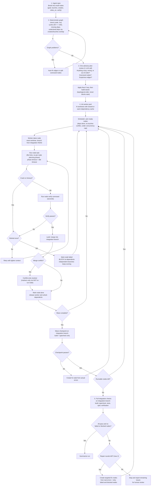

# Software DAG Flow 3.0

Built from your original vision: **spec -> small tasks -> ordered nodes -> one worktree per node -> review the order -> integrate as nodes finish.** Version 3.0 keeps the 1.0 structure and its checkpoints, but removes the overhead that caused timeouts and the 10-hour startup.

## Principles

1. **Small nodes are preferred.** 150 nodes that work 9/10 times beat 50 that work 4/10. Run straight chains (A -> B -> C, no branching) in one session on one worktree to avoid per-node overhead.
2. **Only cheap, deterministic checks can block.** Cycles, missing IDs, and undeclared dependencies are checked in code in milliseconds. Anything slower or LLM-based is advisory and never blocks a run from starting.
3. **A failed node blocks its dependents, not the whole run.** Independent branches keep going. Nothing builds on code that doesn't exist.
4. **One fast gate per node, bigger checks at checkpoints.** Per node: a single command taking seconds. Per wave: build and typecheck. End of run: everything.
5. **Never re-run a good task for a merge conflict.** Resolve the conflict markers only.
6. **Each phase has its own timeout,** plus an idle timeout (no output for N minutes). One shared clock lets setup starve the coding step.
7. **Measure first.** Log a timestamp at every phase boundary so slow nodes explain themselves.

## Node Definition

Every node carries what it needs to start editing on turn 1:

| Field | Purpose |
| :--- | :--- |
| `id`, `goal` | What to do, in one or two sentences |
| `depends_on` | Declared dependency edges |
| `touches` | Files the node will edit (also used as hints so the agent skips exploring) |
| `creates` | Files or symbols this node introduces (used to catch undeclared dependencies) |
| `relies_on` | Interfaces or signatures from dependencies it can assume exist |
| `verify` | One fast command that proves the node worked (compile, typecheck, or its own test) |

## Flowchart

## What Changed vs. 1.0

| Area | 1.0 | 3.0 | Why |
| :--- | :--- | :--- | :--- |
| Pre-flight | Full plan contract: sources, sizing, ownership, acceptance | Code-based graph check plus one advisory LLM review | Startup takes seconds, not hours |
| Ordering errors | Hoped contracts would catch them | `creates`/`touches` overlap check finds undeclared dependencies | Toposort alone only sees declared edges |
| Worktrees | Fresh worktree plus setup per attempt | Worker pool with shared or warm dependency cache | Removes cold-start timeouts |
| Per-node steps | Setup, plan, run, contract guards, LLM reviewers | Run, then one fast `verify` command | Removes ~3 LLM phases per node |
| Failure of a node | Retry whole task; strict gates | Retry once, then block dependents only | No cascades from missing code |
| Merge conflict | Landing failure retries whole task | Conflict-only resolver | Keeps good work |
| Validation | Per-node guards plus separate validation pass | Wave checkpoints plus one end-of-run pass | Catches drift early without per-node cost |
| Final review | Optional separate review loop | Folded into integration checks and bounded repair rounds | One loop instead of three |
| Timeouts | One budget per attempt | Per-phase and idle timeouts, with logged timestamps | Shows which phase is slow |

## Rules for Adding New Checks

Before adding any check, it must pass all three tests:
1. **Deterministic:** no LLM judgment involved, unless it is advisory.
2. **Fast:** finishes in seconds. Anything slower runs at a checkpoint or the end.
3. **Actionable:** failure produces a specific fix node, not just a halt.

If a check fails these, log it as a warning and let the run continue.
