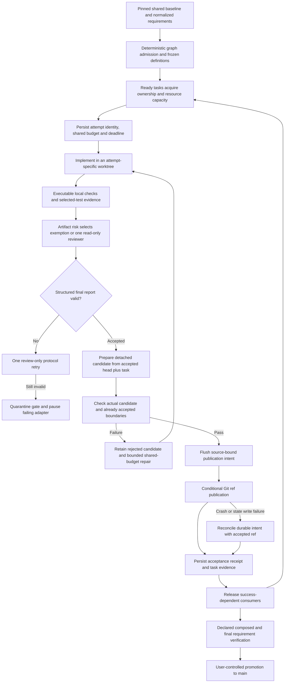
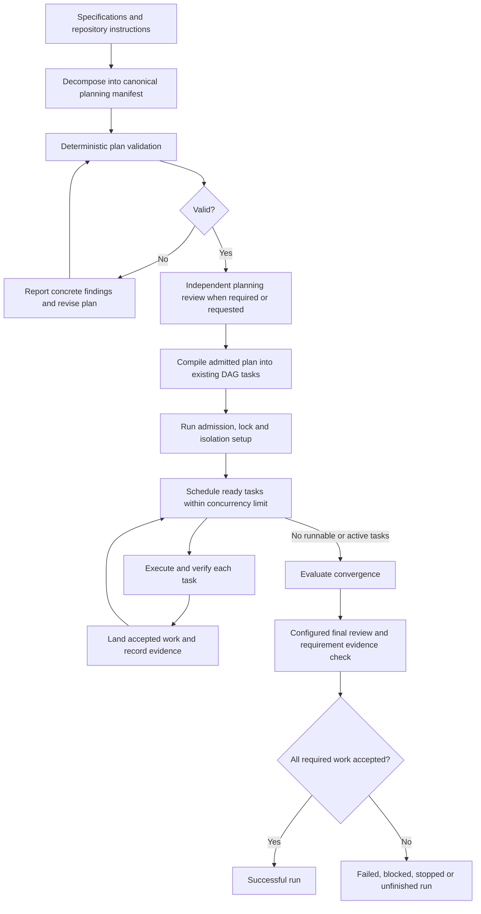
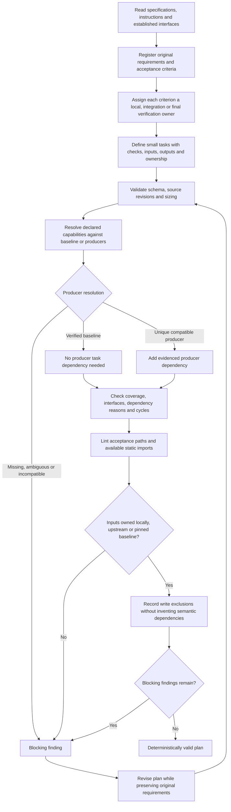
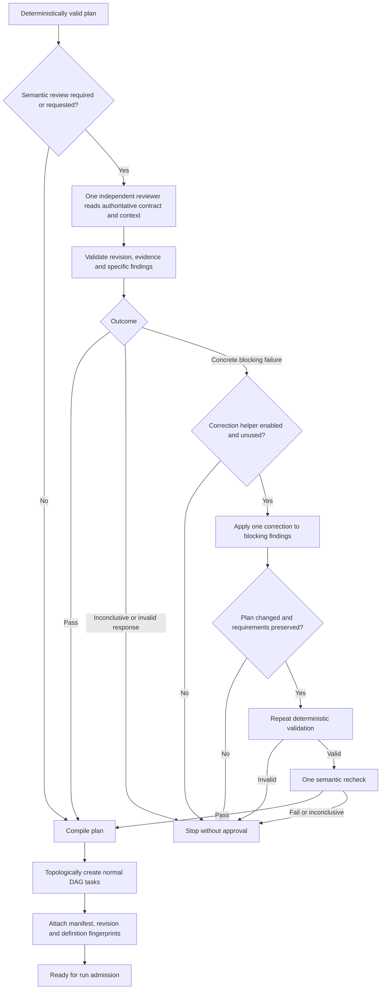
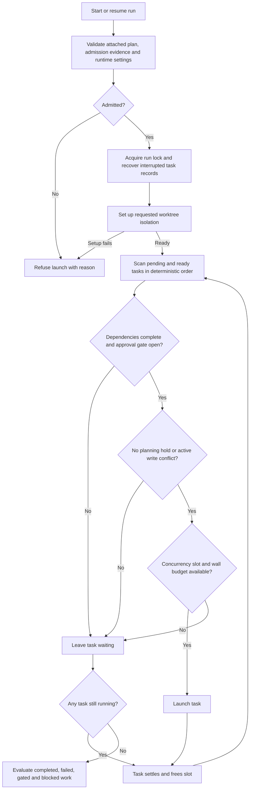
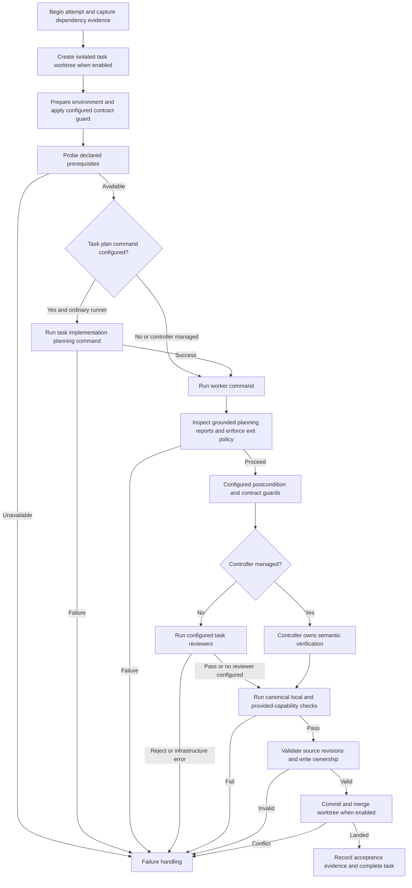
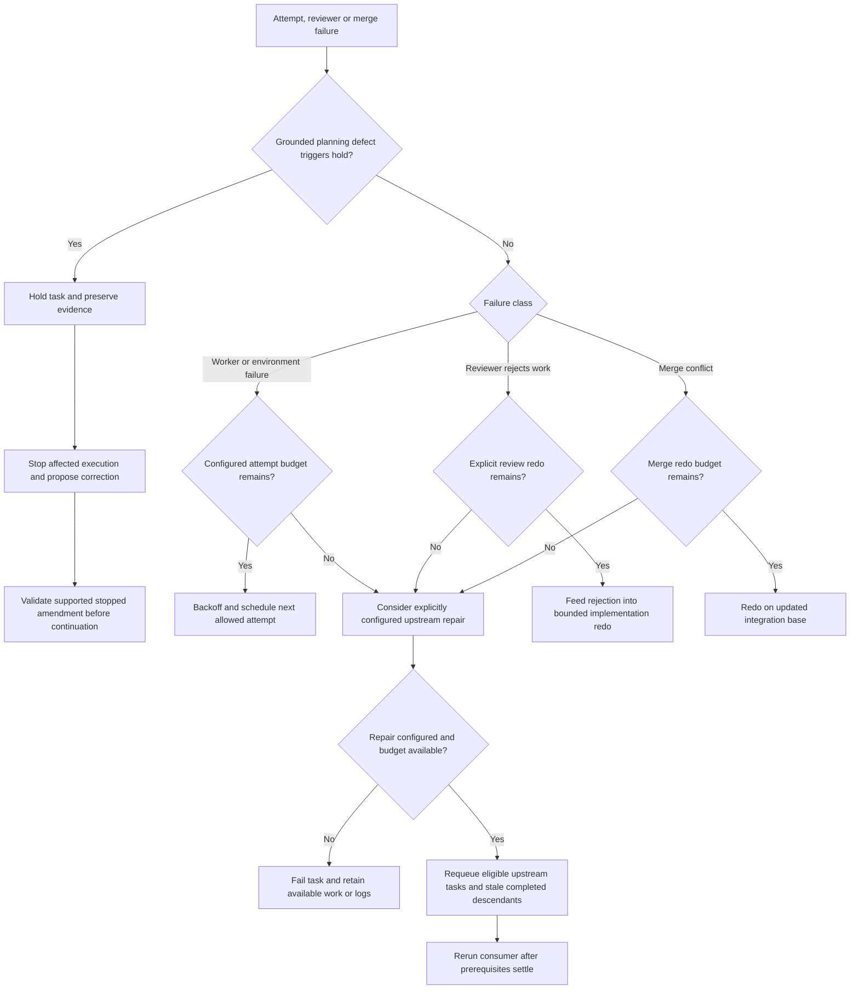
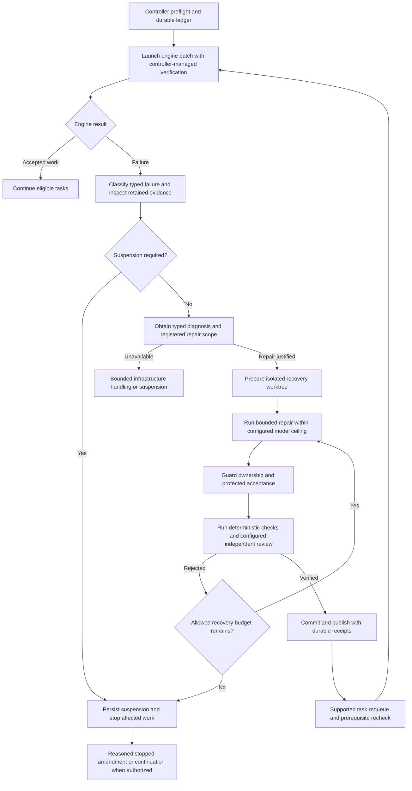
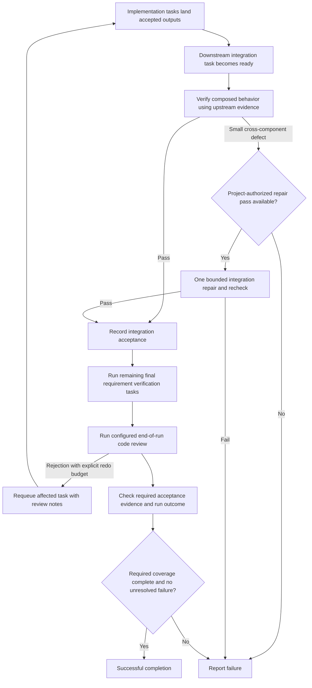

# DAG logical flow

Current working-tree behavior, including the local review simplification changes.
The numbered diagrams below describe the legacy ordinary path. The opt-in
[lean profile](../lean-execution-profile.md) disables inferred task planning and
nested review/upstream repair redos, runs canonical local checks before review,
and rejects reviewer changes to the candidate source. Both paths retry malformed
marker review once through the reviewer alone, then record `review-protocol`
without regenerating implementation. Supported Codex bulk prompts use stdin;
other known coding adapters receive file references for large text arguments.
See the
[implementation status](../recommendations-implementation.md) for the completed workstreams and validation scope.
This describes the canonical planning path and ordinary DAG runner. Optional
reliability-controller recovery is shown separately; it does not run in addition
to the runner's normal review and repair loops.

## Lean execution path

The initial implementation plus two repairs share one persisted allowance. A
task's 45-minute deadline also covers infrastructure retries and integration
queue waiting. Failed/skipped work remains distinct from integrated acceptance.
The detached candidate cannot publish when checks fail, source changes, its
attempt becomes obsolete, or the accepted head changes. Previously published
work is reconciled after interruption without another implementation dispatch.

## Overview

Integration verification is an ordinary downstream task consuming completed
outputs. Its position comes from dependencies; there is no mandatory extra
integration agent after every task.

## 1. Decomposition and deterministic validation

Default sizing is 800 authored characters, at most two owned acceptance criteria,
and one output concern per task. Static lint is deliberately limited: dynamic
loaders, aliases and package scripts may require explicit `check.files` and can
produce nonblocking tracing warnings. Existing files need verified baseline
authority; their presence alone does not prove a prerequisite is available.

## 2. Independent planning review and compilation

The correction helper is an optional API, not an automatic loop inside every
`dag plan review`. Review instructions reserve blocking for concrete execution
problems; polish and speculative suggestions remain nonblocking. A changed plan
must not silently reuse approval for an earlier revision. The project coordinator
may reuse accepted unchanged review packets using its existing evidence checks.

New canonical tasks retain configured reviewers but have `reviewRounds: 0`:
one review pass, no implicit implementation redo. Existing persisted policies
are preserved. Legacy manually authored DAGs remain supported without acquiring
a canonical planning contract automatically.

## 3. Run admission and parallel scheduling

Shared writes can exclude concurrent execution without adding a producer-consumer
edge. A freed slot is refilled immediately. Failed dependency handling follows
the configured policy; a blocked or skipped task does not become accepted work.

## 4. One task attempt

Hard timeouts, silence policy and stop requests apply during subprocess phases.
Supported native `codex exec` prompts travel through stdin, including review
context, so the full specification does not overflow Windows command arguments.
Task-local checks run after reviewers so evidence describes the artifact being
landed. A task's local success does not satisfy downstream integration criteria.

## 5. Ordinary-runner failure routes

New canonical tasks have no implicit review redo. Grounded future-file ownership
failures hold immediately; other planning reports must meet the runtime evidence
rules and can require repetition. Generic missing-module text alone is not proof
of a graph defect.

The existing `repairRounds` mechanism can requeue completed descendants broadly.
It is different from a project-authored integration repair task and is not
automatically enabled by these changes. This diagram exposes that existing route;
it does not recommend enabling it for every integration node.

## 6. Optional reliability-controller recovery

The controller has separate infrastructure and substantive rejection budgets.
Its state machine retains receipts across interruption. It is an optional
execution mode, not another mandatory review layer after the ordinary runner.

## 7. Integration and final convergence

The one-pass integration repair policy belongs to the analytics project; generic
DAGs must declare their own policy. It cannot stand in for missing implementation
or weaken final acceptance. End-of-run code review is optional and distinct from
executable requirement verification; its behavior depends on the saved review
mode and budgets. A run-level final-review failure is advisory to task state but
still produces an unsuccessful run outcome.

## Code anchors

- `src/planning/validation.ts`: `validatePlan`
- `src/planning/acceptance-lint.ts`: `lintAcceptance`, `forwardReferenceFailure`
- `src/planning/review.ts`: `reviewPlan`, `reviewCorrectionCycle`
- `src/planning/compile.ts`: `compilePlan`, `plannedTaskInput`
- `src/planning/runtime.ts`: planning admission, holds and acceptance evidence
- `src/runner.ts`: `start`, `runTasks`, `executeTask`, `reviewPass`, `failAttempt`,
  `tryRepair`, `finalReviewPass`
- `scripts/reliability/controller.mjs`: optional durable recovery controller
- `src/codex-transport.ts`: supported Codex prompt transport
